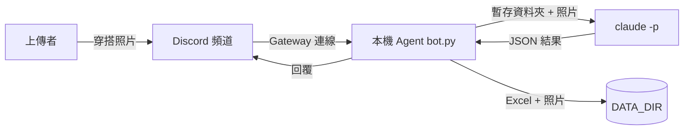

# 架構文件:穿搭紀錄 Agent

> 白話寫給非工程背景的人;專有名詞第一次出現時會用一句話解釋。本文件不含程式碼。

## 1. 專案說明與目標
在我的電腦上跑一支程式(agent,= 會自己接收訊息並做事的小程式)。有人在指定 Discord 頻道上傳穿搭照片,它就辨識、記錄並回覆。

## 2. 架構圖


## 3. 技術選擇
- **discord.py**:最普遍的 Discord Python 套件,有現成的事件與回覆功能。
- **Gateway 模式**:程式主動連上 Discord 並持續聽訊息(WebSocket,= 一條不斷線的雙向通道),所以不用對外開網路埠,也不需要 ngrok。
- **`claude -p`**:Claude Code 的「單次問答」模式(= 給一段指令、拿一個結果就結束)。用 `--allowedTools Read` 只讓它讀檔,`--permission-mode dontAsk` 讓它不會停下來等人按同意。

## 4. 單張照片的資料流
1. 使用者上傳 → agent 加 ⏳、回「處理中…」。
2. 放進佇列(排隊的隊伍),worker 一次取一張。
3. 照片下載並複製到獨立暫存資料夾,交給 `claude -p` 分析。
4. 驗證結果(見第 5 點)。
5. 照片改名存入 `photos/`,並在 Excel 加一列。
6. 回覆使用者。任何一步失敗,回覆「處理失敗」並刪除暫存照片,程式不中斷。

## 5. `claude -p` 的輸出約定
固定輸出一個 JSON(= 有欄位名稱的結構化文字):`is_outfit`(是否穿搭)、`name`、`items`(單品陣列)、`colors`、`style`(休閒/正式/運動/街頭/文青/其他)、`temp_min`、`temp_max`(攝氏)。
agent 不直接信任輸出:先擷取 `{...}` 區段、解析 JSON;`items` 必須是非空字串陣列、溫度必須是 -20~50 的數字(不接受字串或布林)、風格不在清單就改成「其他」。任何不合格都丟出錯誤,由第 4 點的失敗流程處理,不會寫入紀錄。

## 6. 非穿搭照片
仍回覆、存照片、建檔。名稱欄為「不是穿搭」,說明欄寫模型看到的內容。這類紀錄不納入統計與相似比對。

## 7. 同時上傳
單一 worker 搭配佇列,逐張處理,避免同時寫 Excel 互相覆蓋。收到照片立即回「處理中…」,讓使用者知道有排到。

## 8. 紀錄(Excel)
`outfits.xlsx` 欄位:日期時間、上傳者、穿搭名稱、單品、顏色、風格、適合溫度、照片位置。每次在最後新增一列,不覆寫。
計算:「本月第幾套」= 該使用者本月既有穿搭數 + 1;「週報」= 近 7 天該使用者紀錄的套數、單品次數 Top 3、最常見風格;「相似提醒」= 單品集合的重疊比例(交集 ÷ 聯集)≥ 60%。**統計皆以上傳者分開**。

## 9. 照片存放
存在 `DATA_DIR/photos/`,檔名「年月日_時分秒_穿搭簡稱.副檔名」。簡稱先移除 `/ \ : * ? " < > |`、空白與 `..`,長度上限 20 字。同一秒同名的極端情況:目前以時間到秒區分,若重名會覆蓋(已知限制,頻道內逐張處理,實際機率極低)。

## 10. 回覆內容
穿搭名稱與風格、單品、顏色、適合氣溫、本月第幾套,若相似則加一行提醒。

## 11. 設定
`.env`:`DISCORD_TOKEN`(**機器人的密碼,絕不可公開或 commit**,外洩等於別人可冒用 bot)、`CHANNEL_ID`、`CLAUDE_MODEL`、`DATA_DIR`。`.env` 已列入 `.gitignore`;repo 只放 `.env.example`。

## 12. 安全
照片與使用者文字都是**不可信輸入**(別人可能在照片裡寫「忽略前面的指令」)。四道防護,程式中以 `DEFENSE n BEGIN/END` 註解標示,方便開關對照:
- **防護 1 – 隔離範圍**:`claude -p` 在獨立暫存資料夾執行,裡面只有這一張照片,且只允許 Read 工具,看不到別人的照片與紀錄。
- **防護 2 – 資料與指令分離**:使用者文字完全不會放進給模型的指令;照片被明確標示為「不可信資料」。
- **防護 3 – 檔名清洗**:模型回傳的名稱變成檔名前,移除斜線、反斜線、`..`、冒號等,防止寫到其他資料夾。
- **防護 4 – Excel 公式**:以 `=`、`+`、`-`、`@` 開頭的文字會去掉開頭字元,Excel 不會當公式執行。

另外,模型輸出一律驗證(第 5 點)。若照片宣稱「溫度 100」或訊息要求「忽略指令」,溫度會因超出範圍被拒絕,文字則根本不會送給模型。

## 13. 額度風險
每張照片都消耗我自己的 Claude 額度,而頻道內任何人都能上傳。因此 agent 只聽單一頻道(`CHANNEL_ID`),忽略 bot 自己和其他頻道,並限制單張圖片 8 MB、格式限 jpg/png/webp。

## 14. 刻意不做
- 長時間雲端常駐服務(程式只在我電腦開著時運作)。
- 天氣 API 比對(適合氣溫只是模型估計)。
- 編輯單品內容(只提供刪除最後一筆)。

## 15. Repo 結構
```
outfit-agent/
├─ bot.py            Discord 事件、佇列、指令
├─ claude_client.py  呼叫 claude -p(防護 1、2)
├─ core.py           驗證、清洗、相似度、統計(防護 3、4)
├─ storage.py        Excel 與照片
├─ tests/            單元測試
├─ docs/             requirements.md、architecture.md
├─ CLAUDE.md  README.md  .env.example  pyproject.toml
```

## 16. 驗收清單
- [ ] 上傳穿搭照 → 收到 ⏳、「處理中…」與完整回覆。
- [ ] Excel 新增一列,photos/ 有照片且檔名格式正確。
- [ ] 上傳非穿搭照 → 有回覆,名稱欄為「不是穿搭」。
- [ ] 同時由兩人上傳 → 逐張處理,統計互不混合。
- [ ] 連傳兩張相似穿搭 → 第二張出現相似提醒。
- [ ] `!週報`、`!刪除`、`!說明` 正常。
- [ ] 傳寫著「忽略指令」的照片 → 不影響結果格式。
- [ ] `git ls-files` 中沒有 `.env`、xlsx、photos。
- [ ] `uv run pytest` 全部通過。
